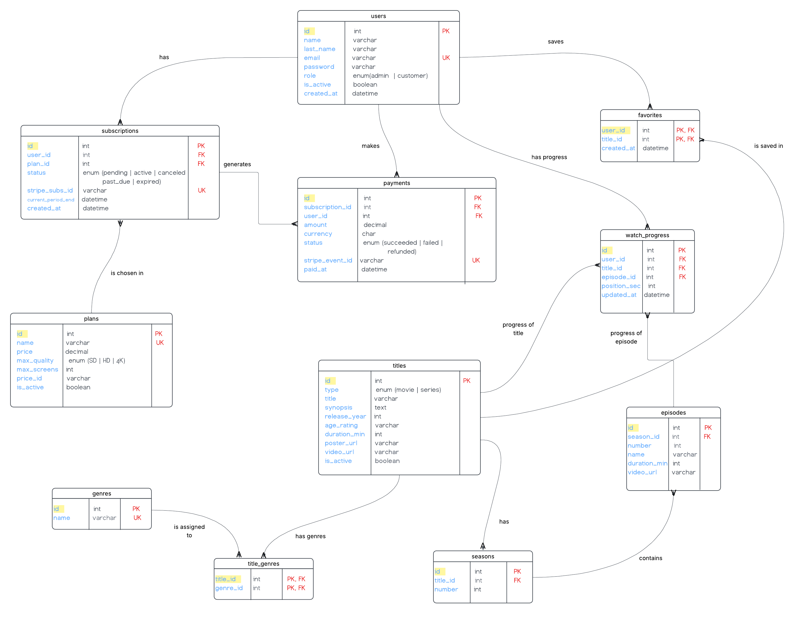

# Streamia

Streamia is a streaming web app, like a small Netflix. Users sign up, pick a subscription plan, pay with Stripe (test mode) and then they can watch movies and series.

Final project for Web Systems Programming at UAA.

## Team

| Member | Works on |
| --- | --- |
| Cristofer Guadalupe Herrera Ramírez | Backend, database, subscriptions and payments |
| Andrea Montserrat Ramírez Martínez | Frontend, catalog, favorites, video player and admin panel |

## Technologies

- **Backend:** Node.js, Express and TypeScript
- **Database:** MySQL with Sequelize
- **Frontend:** React
- **Payments:** Stripe (test mode)

## Documentation

- [Sprint 1 planning](docs/planning_streamia_sprint1.md)
- [Project board](https://github.com/users/montse1113/projects/2)

## ER Diagram

## How we work

We use Gitflow: `main` has the stable version, `develop` joins our finished work, and each task has its own `feature/...` branch. Every change goes through a pull request reviewed by the other teammate.